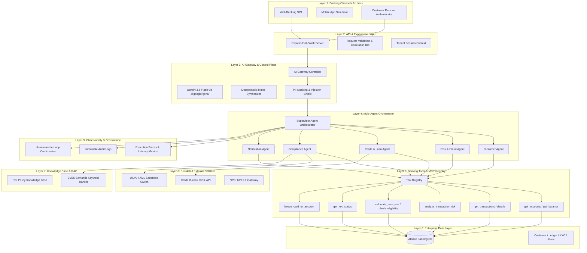

# ConnectBank AI — Intelligent Multi-Agent Banking Platform

ConnectBank AI is a full-stack, enterprise-style simulated banking platform powered by a **Supervisor/Orchestrator Multi-Agent Architecture**, specialized banking agents, an MCP-style tool registry, local regulatory Policy RAG, and an AI Gateway integrating **Google Gemini 3.8 Flash** with a deterministic fallback engine.

---

## 1. System Architecture (9-Layer Banking Model)



---

## 2. Technology Stack

- **Frontend:** React 19, TypeScript, Tailwind CSS v4, Lucide Icons.
- **Backend & API:** Express 4.21, TypeScript via `tsx`, REST API endpoints with correlation IDs.
- **AI Model & Gateway:** Google Gemini 3.8 Flash (`@google/genai` TypeScript SDK) + Offline Deterministic Engine.
- **Validation:** Zod schemas for all 13 tool inputs and query parameters.
- **Data Layer:** In-memory atomic banking repository enforcing customer tenant isolation.
- **RAG:** Local BM25-style policy retriever with RBI Master Directions excerpts and citation scores.

---

## 3. Specialized Multi-Agent Responsibilities

| Agent | Responsibilities | Tools Authorized |
|---|---|---|
| **Supervisor Agent** | Intent classification, subtask decomposition, agent coordination, guardrail enforcement, synthesis, trace recording. | Tool dispatch coordinator |
| **Customer Agent** | Customer 360, account balances, transaction queries, search & filtering. | `get_customer_profile`, `get_accounts`, `get_account_balance`, `get_transactions`, `get_transaction_details` |
| **Risk / Fraud Agent** | Deterministic transaction anomaly detection (geo-velocity, high amount deviation, burst rates), card freeze advice. | `analyze_transaction_risk`, `get_transactions`, `freeze_card_or_account` |
| **Credit / Loan Agent** | Reducing-balance EMI math, Debt-to-Income (FOIR) estimation, credit score underwriting factors. | `get_loan_details`, `calculate_loan_emi`, `check_loan_eligibility` |
| **Compliance Agent** | RBI Master Direction KYC verification, periodic re-KYC requirements, AML watchlist screening. | `get_kyc_status`, `get_customer_profile` |
| **Notification Agent** | Customer communication history, simulated SMS & in-app alerts. | `get_notifications`, `create_simulated_notification` |

---

## 4. Required End-to-End Use Cases

### Use Case 1: Account Inquiry
- **Prompt:** `"What is my account balance, and show my last five transactions?"`
- **Workflow:** `Supervisor -> Customer Agent -> get_accounts -> get_transactions -> Response`
- **Output:** Returns exact account balances and recent 5 transactions with channels and status.

### Use Case 2: Fraud Detection
- **Prompt:** `"Check my recent transactions for suspicious activity."`
- **Workflow:** `Supervisor -> Risk/Fraud Agent -> analyze_transaction_risk -> RBI Dispute Policy RAG -> Response`
- **Output:** Identifies Bucharest, Romania anomaly (₹87,500), score 89/100, recommendations.

### Use Case 3: Loan Eligibility
- **Prompt:** `"Am I eligible for a loan of ₹5,00,000?"`
- **Workflow:** `Supervisor -> Credit Agent -> check_loan_eligibility -> CIBIL Bureau -> Response`
- **Output:** Evaluates Debt-to-Income (FOIR), CIBIL 785 score, max loan capacity, monthly EMI.

### Use Case 4: Reducing-Balance EMI Calculation
- **Prompt:** `"Calculate the EMI for ₹3,00,000 at 10.5% annual interest for 36 months."`
- **Formula:** $\text{EMI} = P \times r \times \frac{(1+r)^n}{(1+r)^n - 1}$
- **Output:** Exact monthly EMI of **₹9,752**, total interest ₹51,062, 3-month amortization breakdown.

### Use Case 5: KYC Verification
- **Prompt:** `"Check whether my account has pending KYC requirements."`
- **Workflow:** `Supervisor -> Compliance Agent -> get_kyc_status -> RBI Master Direction RAG -> Response`
- **Output:** Displays current compliance status (Verified vs Re-verification Due) with missing document details.

### Use Case 6: Multi-Agent Banking Summary
- **Prompt:** `"Summarize my balance, check recent fraud alerts, and tell me my current loan EMI."`
- **Workflow:** Supervisor decomposes into 3 concurrent subtasks:
  1. Customer Agent retrieves balance
  2. Risk Agent screens for fraud alerts
  3. Credit Agent fetches loan details and active EMI
- **Output:** Unified consolidated brief showing multi-agent cooperation and verifiable tool results.

---

## 5. User Creation, Credentials & Database Persistence

ConnectBank AI supports complete user registration, credential generation, and persistent database storage:

- **Database File:** Stored on disk in `data/connectbank_db.json`.
- **Automatic Synchronization:** Every user creation, profile update, account deposit, KYC verification, or security freeze is persisted to the database on disk.
- **REST Endpoints:**
  - `POST /api/users/create`: Registers a new user, hashes/stores credentials, generates masked PAN & Aadhaar, provisions a primary bank account with an initial deposit, creates KYC records, and writes to the database.
  - `POST /api/auth/login`: Authenticates username and password credentials against records stored in the database.
  - `GET /api/users`: Fetches all registered users, roles, creation timestamps, and linked customer IDs from the database.
- **Interactive UI:**
  - **Create User Button:** Accessible directly from the top header bar, customer persona switcher, and System Status page.
  - **User Login Modal:** Allows credential sign-in and provides quick one-click autofill for testing stored credentials.
  - **Database Users Table:** Located in **System & Status**, displaying all stored users, credentials, and session switcher buttons.

---

## 6. Security & Governance Design

1. **Multi-Tenant Customer Isolation:** Every data-access operation enforces ownership against the authenticated customer ID. Cross-customer queries (e.g., asking for another user's balance) are immediately intercepted by security guardrails.
2. **PII Masking:** Automatic regex-based masking of PAN numbers (`ABCPS****K`), Aadhaar (`XXXX-XXXX-4821`), and phone numbers.
3. **Prompt Injection Defense:** Blocks jailbreak attempts, unauthorized instruction overrides, and SQL injection patterns.
4. **Human-in-the-Loop (HITL) Confirmation:** Destructive state-changing actions (such as card or account freezing) require user confirmation before execution.
5. **No Direct Model Database Access:** Gemini cannot directly execute database operations or arbitrary code; deterministic code validates and authorizes all tool calls.

---

## 6. Seed Customer Personas

- **CUST-1001: Aarav Sharma** — Tech Lead, Bengaluru. Income ₹1,65,000/mo, CIBIL 785. Has active Personal Loan (₹4.5L), 1 suspicious overseas transaction in Bucharest flagged.
- **CUST-1002: Priya Patel** — SME Director, Ahmedabad. Income ₹2,90,000/mo, CIBIL 715. Has active Home Loan (₹45L), periodic KYC re-verification due (missing address proof).
- **CUST-1003: Rajesh Kumar** — Senior Citizen, Lucknow. Pension ₹62,000/mo, CIBIL 825. High FD balances, 100% compliant, zero fraud alerts.

---

## 7. Setup & Run Instructions

```bash
# 1. Install dependencies
npm install

# 2. Run the automated test suite
npm test

# 3. Start development server (serves both API & Frontend on port 3000)
npm run dev

# 4. Build for production
npm run build
```

---

## 8. Demo Walkthrough Script (5–10 Minutes)

1. **Introduction (1 min):** Highlight ConnectBank AI's 9-layer banking architecture, supervisor orchestrator, and real-time observability.
2. **Dashboard Overview (1 min):** Show customer Aarav Sharma's consolidated balance, active loan, and the urgent red security banner alerting an overseas POS charge.
3. **Account Inquiry (1 min):** Open AI Assistant and run `"What is my account balance, and show my last five transactions?"`. Expand the **Execution Trace Viewer** to show the tool calls and duration.
4. **Fraud Detection & HITL (1.5 min):** Run `"Check my recent transactions for suspicious activity."`. Observe the 89/100 risk score and Romanian geo-anomaly. Then type `"Freeze my card immediately"` to showcase the Human-in-the-Loop confirmation modal.
5. **Credit & EMI Mathematics (1.5 min):** In the Loans page, adjust principal and interest sliders to demonstrate the reducing-balance EMI formula and amortization breakdown.
6. **Persona Switching & Tenant Isolation (1.5 min):** Switch persona to Priya Patel to view her pending KYC status. Switch back to Aarav and ask `"Show me Priya Patel's account balance"` to demonstrate tenant isolation denial.
7. **Agent Monitor & System Status (1 min):** Visit the **Agent Monitor** to review recorded execution traces and examine the interactive 9-layer architecture map.
